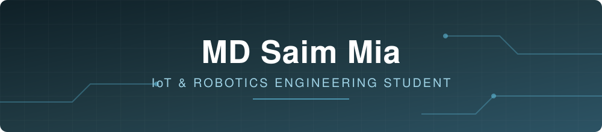

 

 

---

## About

I'm a first-year IoT and Robotics Engineering student at the University of Frontier Technology. I like projects where software meets real hardware: a display that reacts to touch, a sensor that reports data, a mechanism that actually moves.

Alongside my engineering studies, I build websites with HTML, CSS and JavaScript. It started as a side skill and turned out to be a useful way to present and share what I make.

Right now I'm getting stronger in C, learning JavaScript properly, and picking up AutoCAD for mechanical design.

---

## Tech Stack

### Embedded Systems and Electronics

| Area | Tools and Components |
|---|---|
| **Microcontrollers** | ESP32, Arduino (Uno / Nano) |
| **Programming** | C, Arduino IDE, Arduino framework |
| **Displays** | SH1106 and SSD1306 OLED (128x64) |
| **Inputs and sensors** | Capacitive touch, push buttons, ultrasonic sensor, IR sensor, temperature and humidity sensor |
| **Actuators** | Servo motors, DC motors, motor driver (L298N), buzzer, LEDs |
| **Communication** | I2C, UART, Wi-Fi |
| **Prototyping** | Breadboard, jumper wiring, power supply and basic circuit design |

### Web Development

| Area | Tools |
|---|---|
| **Frontend** | HTML5, CSS3, JavaScript (learning), responsive design |
| **Backend / Data** | Supabase |
| **Deployment** | GitHub Pages |

### Design and Workflow

---

## Projects

### Hardware and Engineering

| Project | Hardware / Tools | Description |
|---|---|---|
| **NIMO** | ESP32-WROOM, SH1106 OLED, capacitive touch (GPIO4), Wi-Fi | A small emotion bot with an animated OLED face, touch interaction, and clock and weather pages. In development. |
| **Mars Rover** | AutoCAD | Drawing of a six-wheel rocker-bogie rover, made for my Engineering Drawing course. |
| **Library Management System** | C | Console-based library system with sorting by ID, name and author, and runtime password change. |

### Web

| Project | Description | Link |
|---|---|---|
| **RoboHub** | Concept website for a university robotics club. | [View](https://saimworks00-sketch.github.io/Robohub/) |
| **BizFlow** | Dashboard concept for small shop owners to track their business. | [View](https://saimworks00-sketch.github.io/bizflow/) |
| **Status Tracker** | A simple app to track progress of tasks. | [View](https://saimworks00-sketch.github.io/Status-Tracker/) |

---

## Currently

- Building more embedded projects with ESP32 and Arduino
- Writing cleaner, more structured C
- Learning JavaScript beyond the basics
- Getting comfortable with AutoCAD

## Goal

To build robotic and cyber-physical systems end to end: the electronics, the firmware, and the interface people use to interact with them.

---

## GitHub Activity

